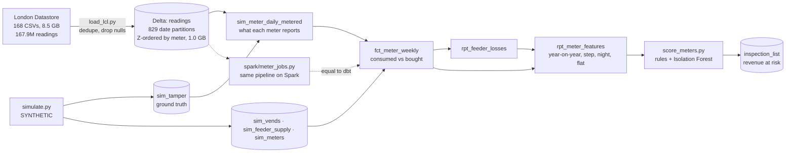

# Smart-Meter Revenue Protection

[](https://github.com/Saigwe/smart-meter-revenue-protection/actions/workflows/ci.yml)

> 167.8 million real half-hourly readings from 5,561 London households (UK Power Networks' Low Carbon London trial) in Delta Lake, partitioned by date and Z-ordered by meter. A prepaid-utility simulation on top plants four kinds of energy theft on 3% of meters. Detection uses only what a utility can see: the weekly gap between energy consumed and energy bought, feeder losses, and explainable rules plus an Isolation Forest. It's scored against the planted cases, giving a ranked inspection list with revenue at risk. The same pipeline runs as Spark jobs, checked equal to dbt in CI.

**Author:** Stanley Igwe, Lead Data (Analytics) Engineer · [Portfolio](https://saigwe.github.io)
**Stack:** Python · Delta Lake (delta-rs 1.6; Delta on Spark 4.0) · DuckDB · dbt Core (unit tests on external Delta sources) · PySpark 4.0 · scikit-learn · pytest · GitHub Actions
**Status:** Core build complete on the full London dataset. See [Roadmap](#roadmap).

Project 17 of my portfolio plan. At a Nigerian electricity distribution company I analysed smart-meter (AMI) and vending data in SQL, recovering NGN 5M in revenue in three months, and supervised smart-meter rollout surveys on a high-loss feeder. This repo rebuilds the problem on public and synthetic data. No employer or client data, code or logic is used.

---

## 90-second summary
| | |
|---|---|
| **Problem** | Distribution companies lose revenue to bypassed meters, tampered credit and stuck meters. Inspectors can visit only a few homes a week, so the list of where to go must be short and right. |
| **What I built** | A Delta lake of every real reading. A simulation that adds what a prepaid utility also has (vends, feeder supply) and plants theft as ground truth. dbt applies the tampering without rewriting the real data, then builds the weekly consumed-vs-bought gap, feeder losses and per-meter features. The scoring ranks meters with rules and an Isolation Forest, scored against the planted cases. The Spark version of the pipeline is tested equal to dbt. |
| **Why it matters** | An inspection list where more than half of the top 167 are real cases, against a 3.2% base rate (17x better than random), each with the rule that fired and the revenue at stake. |
| **Proof** | [Numbers](#numbers), from the full 167.8M-row run; detection reports in [`results/`](results). |

## Architecture


`sim_meter_daily_metered` is the only place the ground truth touches the data. A lineage test reads dbt's manifest and fails if any detection model reaches `sim_tamper` or the household's real (unmetered) use any other way.

## Data
- **Real:** [SmartMeter Energy Consumption Data in London Households](https://data.london.gov.uk/dataset/smartmeter-energy-consumption-data-in-london-households-vqm0d) (UK Power Networks, London Datastore, no sign-in). 5,566 households, half-hourly, November 2011 to February 2014, 167,932,474 rows, about 1,100 of them on a dynamic time-of-use tariff during 2013.
- **Cleaned:** 5,560 null readings dropped and 115,453 duplicate meter-timestamp pairs collapsed, leaving 167,811,461 readings from 5,561 meters (five meters had only nulls).
- **Synthetic, fixed seed** (`ingestion/simulate.py`):
  - 40 feeders (supply = real use × 4–7% technical loss + noise).
  - 217,782 prepaid vends of £10–£40 bought when credit runs low.
  - 167 tampered meters (3%) from a date between March and September 2013, four ways (below).

| Planted theft (42 each, 41 night) | What the meter reports | What the customer buys |
|---|---|---|
| bypass | 30–50% of real use | what is metered |
| credit tamper | real use (honest meter) | ~30% of it |
| flatline | a constant low value | what is metered |
| night bypass | nothing 00:00–06:00 | what is metered |

## Data model
| Model | Purpose |
|---|---|
| `sim_meter_daily_metered` | Real readings → what each meter reports per day (tampering applied), with night energy and distinct values. 3.5M meter-days. |
| `sim_meter_daily_truth` | Real use per day. Used only for reconciliation and to check revenue estimates. |
| `fct_meter_weekly` | Per meter and week: metered energy, night energy, flat days, energy bought, gap. 505,269 rows. |
| `rpt_feeder_losses` | Per feeder and week: supply vs metered, loss share, excess over the same season a year earlier. |
| `rpt_meter_features` | Oct–Dec 2013 vs Oct–Dec 2012 per meter: consumption ratio (and vs the feeder's median), purchase ratio, night share, flat days, the sharpest 6-week step, feeder confirmation. |

## Tests
- **Reconciliation:** every real reading reaches the daily table, and every honest meter reports exactly its real use.
- **Unit test:** each tamper type changes only what the meter reports, and only from its start date. Credit tampering leaves the meter honest.
- **Lineage:** no detection model reads the ground truth or real use, except through the one metered boundary.
- **Spark equals dbt:** daily metered energy, weekly gap and feeder losses match to the watt-hour (CI).
- Plus non-negative energy, grain and key tests.

## Numbers
Full run on a laptop (DuckDB + delta-rs). Spark timings from GitHub Actions.

| Step | Result |
|---|---|
| CSV → Delta (167.9M rows → 167.8M) | 3 min 43 s (write 2 min 47 s, Z-order 44 s); 8.5 GB of CSV → 1.0 GB of Delta in 829 date partitions |
| Simulation | 1 min 6 s (217,782 vends, 33,020 feeder-days) |
| dbt build | 24 nodes (5 tables, 3 views, 15 data tests, 1 unit test) in 4 min 1 s; the metered daily model over all 167.8M readings is 3 min 48 s |
| Scoring | 26 s |
| **Spark 4.0 on 20M real readings** (CI, 4 cores) | metered daily 22.0 s, weekly gap 4.7 s, feeder losses 2.2 s |

**Detection against the 167 planted cases** among 5,200 meters reporting in both windows ([results](results/detection.md)):

| Method | Precision in top 50 | Top 100 | Top 167 |
|---|---:|---:|---:|
| Rules (severity-weighted) | 58.0% | 50.0% | **54.5%** |
| Isolation Forest (unsupervised) | 48.0% | 45.0% | 32.9% |
| Combined (rank average) | 58.0% | 50.0% | 54.5% |

- **Rules catch nearly everything:** at least one rule fires for 160 of the 167 planted meters (95.8%), across 450 flagged meters (35.6% precision).
- **By type, in the top 167:** all 42 flatlines and 33 of 41 night bypasses, but only 14 credit tampers and 2 bypasses. A bypass looks exactly like a household that really cut its use.
- **Time-of-use tariff:** 18% of false positives are time-of-use customers, about their 20% share of all meters, so the 2013 tariff trial didn't create false alarms.
- **Revenue at risk:** the top 167 represent £55,772 a year. Estimated unbilled energy for planted meters is 1.06x the true amount.
- **Feeder losses:** baseline loss averages 5.5%, rising to 6.8% in Oct–Dec 2013. Excess loss correlates 0.54 with planted cases per feeder (2.0 points on feeders with 6 or more, 0.7 on feeders with 2 or fewer), so feeders can be prioritised.

**What changed the results, in order:**
1. **Year-on-year rules** ([v1](results/detection_v1_year_on_year.md)) reached 46.1% precision in the top 167. Real households change a lot between years.
2. **Requiring an abrupt, lasting step** for the drop and night rules, and scoring by severity, raised it to 54.5% (current).
3. **Confirming each drop with the feeder's energy balance** ([v3](results/detection_v3_feeder_confirmation.md)) cut it to 37.7%, so it was reverted. With about 140 meters a feeder, one household's drop is about the size of the feeder's measurement noise. Confirming a single bypass needs metering at transformer level. The feature stays in `rpt_meter_features` so the experiment is reproducible.

## How to run
Requires **Python 3.12** (what CI uses) and `make`; Spark also needs Java 17.
```bash
python -m venv .venv && source .venv/bin/activate   # Windows: .venv\Scripts\activate
pip install -r requirements.txt
make download && make all     # 759 MB download, 8.5 GB extracted; load, simulate, dbt, score, tests (~10 min)
make fixture-all              # 200 synthetic households in the same file format (CI)
pip install -r spark/requirements.txt && make spark   # the Spark version (needs Java)
```

## Roadmap
- [x] Scaffold: fixture, staging with key tests, first marts, CI
- [x] Ingest the London half-hourly readings into Delta, partitioned by date and clustered (Z-ordered) by meter
- [x] Synthetic prepaid vends with planted theft: sudden drops, credit tampering, flat lines, night use without metering
- [x] Weekly consumed-vs-purchased gap per meter and loss % per feeder
- [x] Anomaly score (rules plus isolation forest); precision on planted cases, by type
- [x] Ranked inspection list with revenue at risk; Spark job timings (CI, real data)
- [ ] Transformer-level energy balance to confirm single bypasses
- [ ] Incremental daily loads (Delta MERGE) instead of a full reload
- [ ] 3-minute Loom walkthrough ([script ready](docs/walkthrough.md))

## Interview topics this project prepares
- Lakehouse layout at scale: partitioning vs clustering (Z-order), file sizes, compression
- Revenue protection analytics: energy balance, consumed vs vended, and why bypasses are hard
- Evaluating anomaly detection honestly: planted ground truth, precision at k, keeping truth out of features
- Spark vs DuckDB: when a laptop is enough, and how to prove two engines agree

## Data and licence
- **Low Carbon London smart-meter data:** © UK Power Networks, via the London Datastore, under its open licence.
- **Simulation and CI fixture:** synthetic, fixed seeds; they describe no real customer's behaviour beyond the real readings.
- **Code:** MIT (see `LICENSE`).
