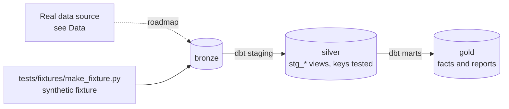

# Smart-Meter Revenue Protection

[](https://github.com/Saigwe/smart-meter-revenue-protection/actions/workflows/ci.yml)

> Half-hourly smart-meter data processed at scale to find likely energy theft: the gap between energy consumed and energy bought, per meter and feeder, ranked for inspection with revenue at risk.

**Author:** Stanley Igwe, Lead Data (Analytics) Engineer · [Portfolio](https://saigwe.github.io)
**Stack:** PySpark on Databricks (free edition) · Delta Lake · DuckDB (laptop version and CI) · dbt Core · scikit-learn (isolation forest)
**Status:** 🚧 Scaffolded. Fixture pipeline passes: `dbt build` 22/22. See [Roadmap](#roadmap).

Project 17 of my portfolio plan. At a Nigerian electricity distribution company I analysed smart-meter (AMI) and vending data in SQL, recovering NGN 5M in revenue in three months, and supervised smart-meter rollout surveys on a high-loss feeder. This repo rebuilds the problem on public and synthetic data. No employer or client data, code or logic is used.

---

## 90-second summary
| | |
|---|---|
| **Problem** | TODO: one sentence on the business problem. |
| **What I built** | TODO: fill in as the roadmap lands. |
| **Why it matters** | TODO: the decision this enables, in the user's words. |
| **Proof** | TODO: link to [Numbers](#numbers), with every claim reproducible. |

## Architecture


## Data
Real data: [Smart meters in London](https://www.kaggle.com/datasets/jeanmidev/smart-meters-in-london) (UK Power Networks Low Carbon London trial, 5,567 households, half-hourly, ~167M rows). Add synthetic prepaid vends with planted theft patterns. CI uses a two-week synthetic fixture.

| Bronze table (fixture) | Rows |
|---|---|
| `bronze.feeders` | 10 |
| `bronze.meters` | 300 |
| `bronze.readings` | one per meter per `30min` period, 2025-01-06 00:00:00 to 2025-01-19 23:30:00 |
| `bronze.vends` | 2,500 |

## Data model (gold layer, first cut)
| Model | Purpose |
|---|---|
| `rpt_meter_weekly_gap` | Energy consumed vs energy bought per meter per week. A large positive gap suggests bypass or theft. |
| `rpt_feeder_losses` | Report model |

## Tests in place
- Staging: `unique` / `not_null` on every key, and `relationships` on every foreign key
- Marts: grain tests (`unique_combination`) and accepted values
- Business rules: `assert_consumption_not_negative`

## Numbers
*(Fill from real runs. Never estimate.)*
| Metric | Value |
|---|---|
| Rows processed (real data) | _tbd_ |
| dbt models / tests | _tbd_ |
| `dbt build` runtime | _tbd_ |

## How to run
Requires **Python 3.12** (what CI uses) and `make`, or run the commands in the `Makefile` by hand.
```bash
python -m venv .venv && source .venv/bin/activate   # Windows: .venv\Scripts\activate
pip install -r requirements.txt
make fixture-all   # synthetic fixture -> dbt build (used in CI)
```

## Roadmap
- [x] Scaffold: synthetic fixture, staging with key tests, first marts and business-rule tests, CI
- [ ] Ingest the London half-hourly readings into Delta, partitioned by date and clustered by meter
- [ ] Synthetic prepaid vends with planted theft: sudden drops, flat lines, night use without vends
- [ ] Weekly consumed-vs-purchased gap per meter and loss % per feeder
- [ ] Anomaly score (rules plus isolation forest); precision on planted cases
- [ ] Ranked inspection list with revenue at risk; Spark job timings
- [ ] Fill in [Numbers](#numbers) and the [design doc](docs/design_doc.md)
- [ ] 3-minute Loom walkthrough

## Interview topics this project prepares
- Large time-series processing
- Partitioning and clustering
- Anomaly detection
- Energy loss metrics

## Data and licence
- **Fixture:** synthetic, generated with a fixed seed by `tests/fixtures/make_fixture.py` from `fixture_spec.yml`. It describes no real company or person.
- **Real data:** see [Data](#data) for each source's own licence and terms.
- **Code:** MIT (see `LICENSE`).
